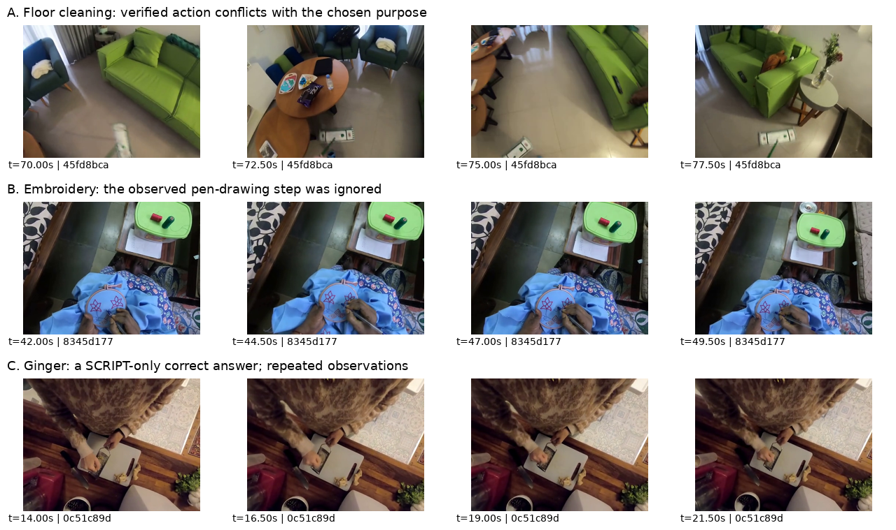
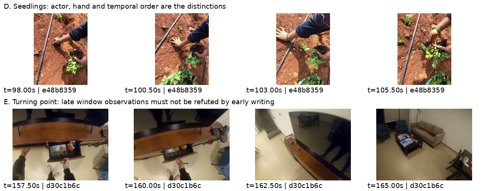

# SCRIPT：300 题准确率、耗时与具体 case 分析

分析日期：2026-10-16，新加坡时间。本文使用已经完成的固定 300 题，包含复用的 V7c 原 100 题和新增 200 题。500 题实验继续运行，其新增结果不混入本文。

**当前最明确的问题是：取证经常没有围绕选项差异展开；即使已经取得正确事实，核验和最终选择也会错误解释这些事实。速度则主要消耗在反复观察、核验和评估，以及新建基础库时失败的摘要生成上。**

本次对 300 题做了全量日志统计，详细追踪了下文 9 个 case，并查看了其中数个 case 保存的实际输入帧。文中的“正确答案”指数据集标注；观察事实、程序状态和我的判断分别说明。各类问题对总准确率的独立贡献，需要后续消融确认。

结果和证据入口：

- [本次分析冻结的 300 题结果快照](../workdirs/script-v7c-scaling-100-300-500-20261016-r1/analysis_300/comparison_300_snapshot.json)
- [完整统计](../workdirs/script-v7c-scaling-100-300-500-20261016-r1/analysis_300/aggregate.json)
- [9 个 case 的证据与人工分析](../workdirs/script-v7c-scaling-100-300-500-20261016-r1/analysis_300/case_studies.json)
- [逐题诊断明细](../workdirs/script-v7c-scaling-100-300-500-20261016-r1/analysis_300/query_diagnostics.json)

**一、先看差距的规模：解析失败只解释其中一小部分。**

| 题组 | SCRIPT | VideoTree | SCRIPT 落后 |
| --- | ---: | ---: | ---: |
| 原 100 题 | 52/100，52.0% | 59/100，59.0% | 7.0 个百分点 |
| 新增 200 题 | 105/200，52.5% | 136/200，68.0% | 15.5 个百分点 |
| 合计 300 题 | 157/300，52.3% | 195/300，65.0% | 12.7 个百分点 |

相同问题上的输赢关系如下：

| 结果 | 题数 |
| --- | ---: |
| 两边都对 | 119 |
| SCRIPT 对、VideoTree 错 | 38 |
| VideoTree 对、SCRIPT 错 | 76 |
| 两边都错 | 67 |

VideoTree 比 SCRIPT 多对 38 题，是 76 个失分 case 与 38 个得分 case 抵消后的结果。因此，既要分析失分，也要保留 SCRIPT 已有的优势路径。

SCRIPT 有 6 道解析失败，而且这 6 道 VideoTree 都答对。即使全部修好并答对，准确率也最多从 52.3% 提高到 54.3%，仍落后 VideoTree 10.7 个百分点。核心差距还在正常进入观察和回答流程的问题里。

**二、实际 case 展示：有的没保留关键区别，有的已经看对却选错。**

以下选项统一用语义描述；原始编号为 0–4，可在每个 case 的 JSON 中查看完整题目、所有选项、事实、核验输出和耗时。

**Case 1：清洁地板，被选成重新摆放家具。**

题目问：结合整个视频，人物的主要目标是什么，搬动物品与这个目标有什么关系？

- 标注 / VideoTree：清洁地板，搬开椅子、凳子和桌子是为了让出清洁空间。
- SCRIPT：重新安排家具，把家具放到新的位置。
- 耗时：150.1 秒，7 轮后停止。

这里并不缺“清洁地板”的证据。已经核验的事实包括：

- 18.0–21.5 秒：继续扫地。
- 70–78 秒：用扫帚清洁地板。
- 98.0–100.5 秒：拿拖把拖地。

最终回答甚至引用了“扫帚被用于清洁地板”这条事实，却选了家具布局。gate 也把扫地事实用于支持家具布局，并把“清洁地板”判为反驳。

这说明问题发生在**事实到选项的语义转换**：搬家具是清洁的手段，系统却把手段提升为整体目的；引用一个合法事实 ID，没有保证该事实能够推出结论。

优先改进：检查选项中独有的目的断言，明确区分“正在做的局部动作”和“这些动作服务的总体目标”。

[查看清洁地板 case 的完整记录](../workdirs/script-v7c-scaling-100-300-500-20261016-r1/analysis_300/case_45fd8bca.json)

**Case 2：绣布上画图案，被选成从大块布料剪裁。**

题目问：绣框中的布料如何准备，之后如何使用？五个选项大都包含后续针线刺绣，区别在前期准备：缝制、剪裁、购买、电脑设计，还是用笔画图案。

- 标注 / VideoTree：先用笔在布料上画图案，再刺绣。
- SCRIPT：先从大块布料剪裁，再刺绣。
- 耗时：178.9 秒，8 轮。

42.0–49.5 秒已有一条 supported 事实：人物用笔在绣框内的布料上画图。最终回答引用的却主要是后面的刺绣、调整布料和穿针动作，忽略了直接区分选项的画图事实。

gate 的问题更明显：它多次用同一组“刺绣、调整布料”的事实，把五个不同准备过程全部标为 supported。**共同的后续步骤，被误当成不同前置步骤的证据。**

V7c 已经保留选项文本差异，但文本差异还没有成为必须被证据满足的语义约束。这个 case 需要的是核验“有没有画图 / 剪裁”，继续核验刺绣没有帮助。

[查看绣布 case 的完整记录](../workdirs/script-v7c-scaling-100-300-500-20261016-r1/analysis_300/case_8345d177.json)

下图是系统当时实际读入的帧。第一行是清洁地板；第二行是绣布画图案；第三行是后文会讨论的磨姜正例。图片来自已保存的观察输入，没有重新调用模型。



**Case 3：种苗题的左右手和交接顺序选反。**

题目只问“人物主要用了什么方法种苗”，具体区别隐藏在选项中。

- 标注 / VideoTree：右手拿苗，交给左手，再用右手种入土中。
- SCRIPT：左手拿苗，交给右手，再用左手种入土中。
- 耗时：141.4 秒，8 轮。

系统最后保存了 18 条 supported 事实，但主要是“种下幼苗”“覆土”“种成一排”“用手挖土”。这些事实可以证明在种苗，却不能区分左右手和顺序。

日志暴露了一个具体的信息断点：direct observe 的输入只有图像、字幕、区间、原问题和 `max_claims=3`，**没有选项，也没有选项差异**。原问题没有说左右手，观察模块于是反复产出泛化的种苗描述。任务记录虽然保存了 options，传给观察模型时没有传下去。

最终 answer 也没有顶层图像输入，主要读取文字事实和时间线描述。观察时没有保留的左右手信息，最终回答无法直接从图像补回，只能凭已有文字选择。

这是“看了很多帧，但没有取到需要的信息”的典型例子。改进应把中性的区分目标传给观察模块，例如“记录哪只手拿、交给哪只手、哪只手种入土中”，并允许不清楚时保持未知。

[查看种苗 case 的完整记录](../workdirs/script-v7c-scaling-100-300-500-20261016-r1/analysis_300/case_e48b8359.json)

**Case 4：转折点已经进入观察窗口，最终仍选继续写字。**

题目问：哪个动作说明人物的关注点或目标发生转移？

- 标注 / VideoTree：站起来并打开抽屉。
- SCRIPT：在纸上写字。
- 耗时：154.8 秒，8 轮。

系统已经读了 157.5–165.5 秒的抽屉与离开桌子的画面。observe 提出了“人物关闭抽屉并离开房间”这个合取动作；verify 返回 `supported`，但同时给出 `process_visible=false`。程序按动作证据要求，没有把它存成 supported 事实。

这里不能简单把程序拒绝该复合动作说成 bug：它确实需要足够的过程证据。真正的问题是，系统没有进一步拆开“抽屉状态”“操作抽屉”“离开桌子”等独立事件，保留能确认的部分并追查缺失的部分。

后续 gate 又拿“人物在写字”的局部事实排斥“站起来开抽屉”。**某个时段在写字，无法反驳另一个时段开抽屉。** 最终模型把反复出现的主活动当成题目要求的转折点。

改进应同时处理事件拆分、时间定位和转折语义，避免用动作频率替代“活动变化”。

[查看转折点 case 的完整记录](../workdirs/script-v7c-scaling-100-300-500-20261016-r1/analysis_300/case_d30c1b6c.json)

下面两行分别是种苗和抽屉窗口的实际输入。它们说明这些画面已经进入系统；问题还包括信息抽取和后续使用方式。



**Case 5：面团和托盘，被补全成制作披萨。**

- 题目：人物和另一名男子在整个视频中的总体目的是什么？
- 标注 / VideoTree：烤面包。
- SCRIPT：从头制作披萨。
- 耗时：75.7 秒，8 轮。

8 轮结束后没有 supported 事实。最终解释只提到面团、托盘和搬动托盘，却据此选了披萨。这些线索支持烘焙这个大类，没有直接证明披萨。

这个 case 展示了两件事：观察和核验的召回率可能过低；强制选择时，模型又会用常见场景补出具体目的。应主动寻找产品外观、特有配料或工序，避免把泛化的“面团加工”升级为具体食品。

[查看烘焙 case 的完整记录](../workdirs/script-v7c-scaling-100-300-500-20261016-r1/analysis_300/case_f1d2978d.json)

**Case 6：轴承维修工具题，在解析时就整题失败。**

题目问：维修轮轴承使用了哪些主要工具，每种工具的使用如何变化？

模型生成了类似下面的需求：

```json
{
  "predicate": "at",
  "roles": {
    "object": "target_bag",
    "location": "target_bag"
  }
}
```

`object` 和 `location` 复用同一个变量，违反角色约束。修复调用仍给出同样的结构，查询在 24.3 秒结束，未进入观察和回答。

全部 6 道解析失败的直接错误都是角色变量复用。它们还显示了任务表示的问题：工具、目的和步骤问题被错误映射成 `at`、`close` 等关系；部分题含有 `each/all`，触发严格题型规则，绕过概括题归一化；修复输出也没有稳定保留原始 `task_type`。

改进需要校验语义任务类型和修复结果。对于结构解析失败但描述问答仍可作答的选择题，可以评估同预算内的有限回退；这不需要虚构实体绑定或把证据不足改成充分。

[查看解析失败 case 的完整记录](../workdirs/script-v7c-scaling-100-300-500-20261016-r1/analysis_300/case_b5865ae0.json)

**Case 7：一个次要动作问题，花了 322 秒仍然选错。**

题目问人物在所谓 painting 过程中如何与环境互动，以及做了哪些次要动作。

- 标注 / VideoTree：搬泥土、摸脸。
- SCRIPT：把刷子蘸入油漆。
- 耗时：322.2 秒，8 轮。

解析把问题变成 `interact/all` 和 `other/all`，进入较重的对象关系提取链：

| 操作 | 该题耗时 |
| --- | ---: |
| extract | 130.1 秒 |
| detect | 65.2 秒 |
| assess | 22.5 秒 |
| parse | 22.2 秒 |
| goal | 19.7 秒 |

仅 extract 与 detect 就花了约 195 秒，并发生 3 次软截止。它没有形成更好的答案，反而围绕题面 painting 的预设，选择了常见的蘸油漆动作。

这个 case 说明，任务路由错误会同时损害准确率与速度。需要核对题面预设是否被视频支持，并区分“概括多个动作”和“真正需要穷尽证明的 all”。

[查看慢题 case 的完整记录](../workdirs/script-v7c-scaling-100-300-500-20261016-r1/analysis_300/case_b66bb54a.json)

**Case 8：磨姜答对，说明视觉通路值得保留，但重复取证过多。**

- 题目：整个视频的主要任务是什么，哪些重复动作完成了这个任务？
- 标注 / SCRIPT：磨姜。
- VideoTree：把姜切丁。
- SCRIPT 耗时：154.8 秒，8 轮。

LaViLa 描述混入了切土豆、水果、奶酪等噪声。SCRIPT 在 14–22 秒就保存了磨姜的 supported 事实，后续多个区间再次确认了磨姜，因此最终答对。

这个正例支持保留视觉复核：它提供了描述中不可靠的细节。不过，后续大量事实仍是相同的磨姜动作。该题 observe 花 49.8 秒，verify_claims 花 38.6 秒，gate 花 29.4 秒。最后仍然由 8 轮上限停止。

重复观察可以帮助证明“贯穿视频”的活动，但需要衡量后续观察是否仍在区分磨、切、削皮等候选。当前停止机制没有有效利用已经稳定的区分信息。

[查看磨姜 case 的完整记录](../workdirs/script-v7c-scaling-100-300-500-20261016-r1/analysis_300/case_0c51c89d.json)

**Case 9：有些失分涉及近义选项，需要与明确的系统错误分开审核。**

一题标注是 `cuts the vegetables`，SCRIPT 选了 `chops the vegetables`。已核验事实包括切菜、切碎西兰花茎部。两个选项语义接近，但单标签评分把 SCRIPT 计错。

该题仍按原标注计错，没有调整评测分数。它提示需要单独审核近义、上下位和重叠选项，避免把所有 benchmark 失分都解释成视觉失败。这个单例不足以估计整套数据的标签噪声比例。

[查看近义选项 case 的完整记录](../workdirs/script-v7c-scaling-100-300-500-20261016-r1/analysis_300/case_811deb7d.json)

**三、全量统计支持哪些机制，也排除了哪些猜测？**

观察目标与选项差异之间存在实际断点：在 direct observe 路径里，任务保存了选项，但模型调用只传入原问题作为 goal。对种苗这类“区别藏在选项里”的题，泛化目标会反复产出共同事实。最终 answer 没有顶层图像输入，也不能直接补读被文字抽取漏掉的细节。

选项核验的语义质量也不稳定。300 题共记录 242 次 gate 调用：

| 现象 | 调用次数 |
| --- | ---: |
| 同时把多个选项判为 supported | 142 |
| 五个选项全部判为 supported | 59，包含在上面的 142 次内 |
| selected_option 为 null | 189 |
| 模型自身 passed=true | 139 |

程序拒绝了很多不合法的充分判断，这是必要的保护。但被拒绝的调用已经消耗时间，并且后续取证未必能解决它们暴露的语义问题。

最终只有 8 题以 `protocol_sufficient` 停止，其中 5 题按标注答对、3 题答错。样本很小，不能据此估计普遍正确率，但足以说明：形式上的引用、覆盖和状态检查，不能保证“事实确实推出选项”。

另外，**本批 294 个生成了最终答案的问题，实际模型输入中均没有省略 caption 窗口**。因此，不能再用“正确字幕被上下文截断”解释这批总体失分。SCRIPT 最终输入平均约有 208 行窗口描述，含重叠窗口重复；VideoTree 平均保留约 87 条描述。更多描述与局部事实会带来更复杂的选择问题，但其独立影响仍需对照实验确认。

最终 explanation 的可诊断性也有限：213/294 段解释与所选选项存在完整或前缀复制关系。本文的归因主要依据实际输入、事实与核验链，而不是把模型生成的解释当成可靠推理轨迹。

**四、新建基础库还存在一个此前验收没有暴露的严重问题。**

新增 200 题中，**157 题至少有一个场景摘要不可用，占 78.5%**。原 100 题复用旧 M0，其中有同类问题的为 11 题。

主要失败形式是：

1. 摘要文本超过程序要求的 160 字符。
2. 摘要持续复述原始描述，达到 1024 输出 token 时 JSON 还没有闭合。
3. repair 再次复述同样的长文本，仍无法产生可用摘要。

例如视频 `27829009` 的摘要，把“人物刷门框 / 墙面”的相似描述连续重复。首次 summarize 花 37.5 秒，输出达到 1024 token；repair 又花 37.1 秒，同样达到上限，最终保存为“无法可靠汇总”。

代码中的契约存在不一致：生成 schema 对摘要 `text` 只声明普通字符串，生成后程序才检查长度是否超过 160。长度超限不会在这层自动形成有效压缩。

失败后程序保留窗口原始描述、把场景摘要标为 `unreadable` 并继续构建，所以 `script_build_errors.json` 可以是空的。这里的“构建成功”只说明基础库已保存，并不说明导航摘要可用。

这 157 题都没有进入语义 gate。对于 global 需求，`structural_gate` 明确要求相关场景摘要为 current，因此不可用摘要会阻断这条路径。停止条件又依赖语义 gate 曾经运行，部分题因此一直走到 8 轮上限。

这里必须区分功能故障与准确率因果：

| 新增 200 题内的分组 | 正确率 |
| --- | ---: |
| 至少一个不可用摘要 | 83/157，52.9% |
| 场景摘要都可用 | 22/43，51.2% |

这份观察没有显示坏摘要组的准确率更低，分组也不是随机的。**可以确认摘要故障破坏了导航、闭环和效率，尚不能断言修复它会提高多少准确率。** 原始时间线描述仍在，最终回答仍能利用它们。

修好摘要后，更多问题会进入现有 assess/gate 链，也可能增加在线调用。因此，摘要修复应与停止策略一起评测，不能只以 gate 调用增多作为成功标准。

上轮诊断复用了原 100 题的旧 M0，没有充分覆盖新建库链路；这是本次扩展暴露出的验收覆盖缺口。

**五、速度慢，主要慢在多次模型处理与失败摘要生成。**

已记录的问答流程均值：SCRIPT 130.5 秒/题，VideoTree 27.5 秒/题，前者约为后者的 4.75 倍。两者都不包含外部提供的 LaViLa 描述生成成本；VideoTree 抽帧和特征预处理另行记录，因此这个倍数只比较当前记录的问答流程，不代表严格匹配的完整端到端成本。

SCRIPT 的在线耗时拆解如下。数字来自 300 题 ledger，包含失败题，按每题平均：

| 操作 | 平均耗时/题 | 主要作用或问题 |
| --- | ---: | --- |
| observe | 40.6 秒 | 多个区间反复描述动作 |
| verify_claims | 28.6 秒 | 再读同一批图像，核验候选事实 |
| parse | 16.0 秒 | 把问题转成结构化需求 |
| assess | 14.2 秒 | 多次解释累计事实与需求的关系 |
| gate | 7.5 秒 | 检查选项与充分性，很多调用不能形成有效停止 |
| decode | 6.1 秒 | 读取选定区间的图像 |
| extract | 4.4 秒 | 少数复杂题进入重型关系提取，拉长尾部 |
| detect | 2.7 秒 | 复杂题的目标检测 |
| answer | 2.2 秒 | 生成最终选择与文字 |
| checkpoint_write | 1.6 秒 | 持久化 |

前五项合计约 106.8 秒，相当于平均在线耗时的约 82%。最终答案生成只占约 1.7%。单纯压短最终回答，节约空间有限。

每题平均约调用 20.7 次语言或视觉语言模型，累计读取约 9.7 万输入 token、生成约 3587 个输出 token。输入 token 含图像编码对应 token，累计值不能理解成单次文本上下文长度。

停止机制没有很好地控制重复处理：

- 257/300 题跑满 8 轮。
- 256 题明确因 `global_task_limit` 停止。
- 没有题因实际在线处理总预算耗尽而以 `processing_budget` 结束。
- 2309 个执行轮次中，1276 轮没有新增文本事实，约 55.3%。这是当前文本去重定义下的统计，不意味着这些轮次全部没有价值；跨时间的重复观察仍可支持反复性和覆盖。

这说明仅提高 600 秒预算，对当前主要停止原因没有帮助。关键是让额外轮次取得新的区分信息，并使停止策略识别信息已经足够、或者继续观察已无明显收益。

模型准备与快照校验平均合计约 1.6 秒/题，检索与嵌入平均合计不足 0.2 秒/题。这些环节的优化优先级低于观察、核验、解析和摘要。

新建 M0 的成本还需要单独计算：

| 新增 200 个视频的 M0 操作 | 平均耗时/视频 |
| --- | ---: |
| summarize | 32.0 秒 |
| repair | 12.2 秒 |
| decode | 9.9 秒 |
| inspect | 4.6 秒 |
| features | 4.5 秒 |
| 其余 | 约 2.6 秒 |
| 合计 | 65.8 秒 |

摘要及修复合计 44.2 秒，占 M0 构建的约 67.1%。新增 200 题平均在线问答为 128.6 秒，因此本次新题的已测 M0 加在线处理平均约 194.4 秒。这个数字不能直接与不含独立预处理阶段的 VideoTree 27.5 秒作端到端倍数比较。

当前是两张 H200、每卡两个独立进程。单题处理时间包含共享 GPU 的竞争，不能把“题数 × 单题均值”直接当作整个作业的墙钟时间。

**六、修复应同时针对语义正确性、信息增益与基础库健康度。**

| 优先级 | 要修的问题 | 具体方向 | 验收重点 |
| --- | --- | --- | --- |
| P0 | 新 M0 摘要不可用却被当作构建成功 | 约束摘要字段长度与输出结构；压缩重复动作；把摘要健康度作为独立验收项；摘要不可用时保留可用的窗口检索路径 | 新建库样本的可用摘要比例、截断与修复次数、M0 耗时；不能仅看退出码 |
| P0 | 取证目标没有包含选项区分信息 | 从选项抽出动作、对象、左右手、顺序和目的等独有断言，生成中性的观察目标 | 种苗题能保留手部顺序，绣布题能关注画图与剪裁；不把选项预设写成事实 |
| P0 | 已有事实与最终选项不一致 | 按选项独有断言检查证据；区分目的与手段；显式检查跨时段反驳是否合法 | 清洁地板和绣布 case 不再用正确事实支持不相干选项 |
| P1 | 复合动作核验导致有效部分丢失 | 拆成有时间定位的原子事件；保留能确认的静态状态；缺失过程时定向补帧 | 抽屉 case 保留可确认内容，不把写字当作全局反证 |
| P1 | 解析失败与 each/all 误路由 | 保留修复前后的任务类型；区分概括与穷尽量词；校验角色修复；评估有限的选择题回退 | 6 个解析 case；慢题不再无依据地进入重型关系链 |
| P1 | 大部分问题跑满 8 轮 | 使用新的选项区分信息、答案稳定性和剩余缺口控制后续观察；复用已有事实，减少相同 assess/gate | 正确率与延迟同时报告；不足状态保持真实，不靠伪造充分提前停止 |
| P2 | 近义与重叠选项混入普通错误统计 | 单独人工审核 cuts/chops、上下位目的等案例 | 保持原始 benchmark 分数，另给语义错误类型，避免过拟合措辞 |

不宜只增加轮数：种苗、绣布和清洁地板 case 已说明，缺少目标差异或证据蕴含检查时，更多相同观察不必然带来更好的选择。

也不宜直接删除视觉复核：38 题是 SCRIPT 答对、VideoTree 答错，磨姜 case 提供了具体的有价值视觉证据。更合适的方向是减少不能区分选项的重复调用。

后续实验可以按以下顺序隔离收益，继续冻结模型、问题、标注、预算和生成设置：

1. 单独修复新建 M0，测摘要可用率、建库耗时及在线调用变化。
2. 在相同基础库上，只改变选项差异到观察目标的传递，观察左右手、顺序、前置步骤类题是否改善。
3. 单独改变最终选项比较，检验“证据已正确但选错”的 case。
4. 在准确率基本稳定的设置上，减少重复评估和无区分信息的后续观察，比较平均、P50、P90 和尾部耗时。
5. 每轮同时统计修复的旧错题和丢失的旧对题，并使用尚未参与定向修复的题组做延后验证。

**七、这份结论的边界。**

这 9 个 case 展示了已经在实际日志或图像中确认的机制；没有把全部 143 道错题强行分到同一种原因，也没有通过本次分析重新运行模型或完成因果消融。

坏摘要、错误选项支持和低效循环都有直接记录。它们各自能追回多少正确率、节约多少总耗时，仍需要独立对照。尤其是修复摘要后可能增加在线核验次数，需要同时看质量与成本。

原 100 题、300 题和 500 题互相包含；原 100 题已用于多轮开发，不是独立测试集。新增 200 题与原 100 题的基础库来源也不同。本文保留这些差异，未将各组当作随机化机制实验。

当前最应优先验证的是：**观察是否真正围绕候选区别取证，以及最终选择是否被这些区别的证据约束。** 基础库与停止策略的修复则决定这条链能否以合理成本运行。

可复现性记录：本次分析所用 `comparison_300.json` 的 SHA-256 为：

```text
0f073e97ccc42ab30bada8723f644da78712c3b71373eb77866b50b17e4f8df9
```

统计脚本和逐题证据保存在同一分析目录：[collect_diagnostics.py](../workdirs/script-v7c-scaling-100-300-500-20261016-r1/analysis_300/collect_diagnostics.py)、[enrich_diagnostics.py](../workdirs/script-v7c-scaling-100-300-500-20261016-r1/analysis_300/enrich_diagnostics.py)、[package_report.py](../workdirs/script-v7c-scaling-100-300-500-20261016-r1/analysis_300/package_report.py)。
