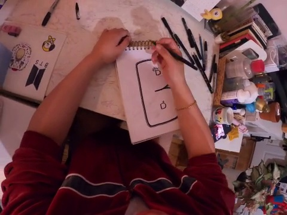
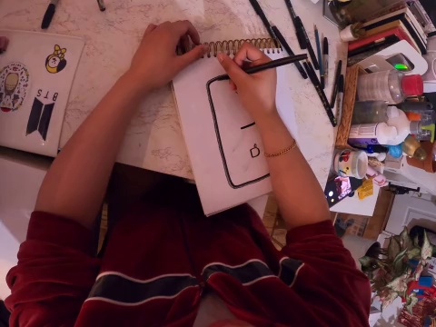

# 从采样点到原文、F解构与K取舍

来源题目：`916476da-a699-4132-b5cb-ae992e647b1b`。只读既有记录，没有重跑模型。索引为1秒采样点，不能当成原视频按原生帧率编号的第N帧。

## 1. 上游实际选中的采样点

K继承上游已选证据，没有重新看图或进行图像选帧。全部索引如下：

```text
0, 1, 2, 3, 4, 5, 6, 7, 8, 9, 10, 11, 12, 13, 14, 15, 16, 17, 18, 19, 20, 21, 22, 23, 24, 25, 26, 27, 28, 29, 30, 31, 32, 33, 34, 35, 36, 37, 38, 39, 40, 41, 42, 88, 89, 90, 107, 108, 109, 110, 111, 112, 113, 114, 115, 116, 117, 118, 119, 120, 121, 122, 123, 124, 125, 126, 127, 128, 129, 130, 131, 132, 133, 134, 135, 136, 137, 138, 139, 140, 141, 142, 143, 144, 145, 146, 147, 148, 149, 150, 151
```

## 2. 每个采样点的原始文本与F实际解构

字段列来自已经保存并接受的事实；“仅原文”表示该行没有接受的结构化字段，不臆造actor/verb/tool。它不自动等于从未请求或模型从未尝试抽取。

| 采样索引 | 区间 | 原始caption | F已接受结构化字段 | K直接候选取舍 | 上游时序候选关联 |
|---:|---|---|---|---|---|
| 0 | [0, 1] | #C C moves book | {"actions": [{"actor": "C", "verb": "moves", "patient": "book"}]} | R0=keep | — |
| 1 | [1, 2] | #C C rubs the paint | {"actions": [{"actor": "C", "verb": "rubs", "patient": "paint"}]} | R1=skip; R2=skip | — |
| 2 | [2, 3] | #C C draws on the paper | 仅原文，无已接受结构化字段 | R3=keep | — |
| 3 | [3, 4] | #C C draws on the painting paper | 仅原文，无已接受结构化字段 | R4=skip | — |
| 4 | [4, 5] | #C C draws a picture | {"actions": [{"actor": "C", "verb": "draws", "patient": "picture"}]} | R5=keep; R6=keep | — |
| 5 | [5, 6] | #C C adjusts the drawing | {"actions": [{"actor": "C", "verb": "adjusts", "patient": "drawing"}]} | R7=skip; R8=skip | — |
| 6 | [6, 7] | #C C moves the book | {"actions": [{"actor": "C", "verb": "moves", "patient": "book"}]} | R0=keep; R9=keep | — |
| 7 | [7, 8] | #C C moves hand on the table | 仅原文，无已接受结构化字段 | R10=skip | — |
| 8 | [8, 9] | #C C moves a rubber on the table | {"actions": [{"actor": "C", "verb": "moves", "patient": "rubber"}]} | R11=skip; R12=skip | — |
| 9 | [9, 10] | #C C draws on the drawing book with a pencil | 仅原文，无已接受结构化字段 | R13=skip | — |
| 10 | [10, 11] | #C C moves pen | {"actions": [{"actor": "C", "verb": "moves", "patient": "pen"}]} | R14=skip | R92=group:R92; R94=group:R94 |
| 11 | [11, 12] | #C C moves the pencil to the right | {"actions": [{"actor": "C", "verb": "moves", "patient": "pencil"}]} | R15=skip; R16=skip | — |
| 12 | [12, 13] | #C C moves the drawing book  | {"actions": [{"actor": "C", "verb": "moves", "patient": "drawing book"}]} | R17=keep; R18=keep | — |
| 13 | [13, 14] | #C C rubs a drawing | {"actions": [{"actor": "C", "verb": "rubs", "patient": "drawing"}]} | R19=skip; R20=skip | — |
| 14 | [14, 15] | #C C rubs a drawing with a rubber | 仅原文，无已接受结构化字段 | R21=skip | — |
| 15 | [15, 16] | #C C rubs a drawing | {"actions": [{"actor": "C", "verb": "rubs", "patient": "drawing"}]} | R19=skip; R20=skip | — |
| 16 | [16, 17] | #C C rubs drawing | {"actions": [{"actor": "C", "verb": "rubs", "patient": "drawing"}]} | R20=skip | — |
| 17 | [17, 18] | #C C  moves hands  | 仅原文，无已接受结构化字段 | R22=skip | — |
| 18 | [18, 19] | #C C scratches the book | {"actions": [{"actor": "C", "verb": "scratches", "patient": "book"}]} | R23=skip; R24=skip | — |
| 19 | [19, 20] | #C C wipes the face | 仅原文，无已接受结构化字段 | R25=skip | — |
| 20 | [20, 21] | #C C scratches her face | {"actions": [{"actor": "C", "verb": "scratches", "patient": "face"}]} | R26=skip; R27=skip | — |
| 21 | [21, 22] | #C C drops pencil | {"actions": [{"actor": "C", "verb": "drops", "patient": "pencil"}]} | R28=skip | — |
| 22 | [22, 23] | #C C draws on the book with a pen  | 仅原文，无已接受结构化字段 | R29=skip | R86=group:R86; R87=group:R86; R90=group:R90; R92=group:R92; R93=group:R93; R94=group:R94; R95=group:R95 |
| 23 | [23, 24] | #C C draws on a paper | 仅原文，无已接受结构化字段 | R30=skip | — |
| 24 | [24, 25] | #C C draws on the book | 仅原文，无已接受结构化字段 | R31=keep | R90=group:R90; R92=group:R92; R93=group:R93; R94=group:R94; R95=group:R95; R96=skip |
| 25 | [25, 26] | #C C draws on the book | 仅原文，无已接受结构化字段 | R31=keep | R86=group:R86; R87=group:R86; R90=group:R90; R93=group:R93; R95=group:R95 |
| 26 | [26, 27] | #C C draws on the paper | 仅原文，无已接受结构化字段 | R3=keep | — |
| 27 | [27, 28] | #C C draws on the book | 仅原文，无已接受结构化字段 | R31=keep | — |
| 28 | [28, 29] | #C C draws on the drawing book | 仅原文，无已接受结构化字段 | R32=skip | — |
| 29 | [29, 30] | #C C draws on a paper | 仅原文，无已接受结构化字段 | R30=skip | — |
| 30 | [30, 31] | #C C draws a picture | {"actions": [{"actor": "C", "verb": "draws", "patient": "picture"}]} | R5=keep; R6=keep | — |
| 31 | [31, 32] | #C C lifts the hand | 仅原文，无已接受结构化字段 | R33=skip | — |
| 32 | [32, 33] | #C C holds the pencil | {"actions": [{"actor": "C", "verb": "holds", "patient": "pencil"}]} | R34=skip; R35=skip | — |
| 33 | [33, 34] | #C C wipes the face | 仅原文，无已接受结构化字段 | R25=skip | — |
| 34 | [34, 35] | #C C moves the book | {"actions": [{"actor": "C", "verb": "moves", "patient": "book"}]} | R0=keep; R9=keep | — |
| 35 | [35, 36] | #C C draws on the paper | 仅原文，无已接受结构化字段 | R3=keep | — |
| 36 | [36, 37] | #C C draws on the paper  | 仅原文，无已接受结构化字段 | R3=keep | — |
| 37 | [37, 38] | #C C draws a picture of a dog  | {"actions": [{"actor": "C", "verb": "draws", "patient": "picture"}]} | R6=keep; R36=skip | — |
| 38 | [38, 39] | #C C draws the sketch with the marker pen | {"actions": [{"actor": "C", "verb": "draws", "patient": "sketch"}]} | R37=skip; R38=skip | — |
| 39 | [39, 40] | #C C draws a picture | {"actions": [{"actor": "C", "verb": "draws", "patient": "picture"}]} | R5=keep; R6=keep | — |
| 40 | [40, 41] | #C C colors a drawing | {"actions": [{"actor": "C", "verb": "colors", "patient": "drawing"}]} | R39=skip; R40=skip | — |
| 41 | [41, 42] | #C C draws on the paper | 仅原文，无已接受结构化字段 | R3=keep | — |
| 42 | [42, 43] | #C C holds the book | 仅原文，无已接受结构化字段 | R41=skip | — |
| 88 | [88, 89] | #C C turns the art book | {"actions": [{"actor": "C", "verb": "turns", "patient": "art book"}]} | R42=skip; R43=skip | — |
| 89 | [89, 90] | #C C picks a pen | {"actions": [{"actor": "C", "verb": "picks", "patient": "pen"}]} | R44=skip; R45=skip | — |
| 90 | [90, 91] | #C C moves hand | 仅原文，无已接受结构化字段 | R46=skip | — |
| 107 | [107, 108] | #C C holds the drawing book | {"actions": [{"actor": "C", "verb": "holds", "patient": "drawing book"}]} | R47=skip; R48=skip | — |
| 108 | [108, 109] | #C C draws a picture of a man  | {"actions": [{"actor": "C", "verb": "draws", "patient": "picture"}]} | R6=keep; R49=skip | — |
| 109 | [109, 110] | #C C draws on the art with a pen  | 仅原文，无已接受结构化字段 | R50=skip | — |
| 110 | [110, 111] | #C C draws on a drawing | 仅原文，无已接受结构化字段 | R51=skip | — |
| 111 | [111, 112] | #C C holds the picture | {"actions": [{"actor": "C", "verb": "holds", "patient": "picture"}]} | R52=skip; R53=skip | — |
| 112 | [112, 113] | #C C turns around | 仅原文，无已接受结构化字段 | R54=skip | — |
| 113 | [113, 114] | #C C draws the picture | {"actions": [{"actor": "C", "verb": "draws", "patient": "picture"}]} | R6=keep; R55=keep | — |
| 114 | [114, 115] | #C C draws on a paper | 仅原文，无已接受结构化字段 | R30=skip | — |
| 115 | [115, 116] | #C C draws on the book | 仅原文，无已接受结构化字段 | R31=keep | — |
| 116 | [116, 117] | #C C draws on a paper  | 仅原文，无已接受结构化字段 | R30=skip | — |
| 117 | [117, 118] | #C C draws a picture | {"actions": [{"actor": "C", "verb": "draws", "patient": "picture"}]} | R5=keep; R6=keep | — |
| 118 | [118, 119] | #C C holds the art | {"actions": [{"actor": "C", "verb": "holds", "patient": "art"}]} | R56=skip; R57=skip | — |
| 119 | [119, 120] | #C C draws on a paper  | 仅原文，无已接受结构化字段 | R30=skip | — |
| 120 | [120, 121] | #C C paints a picture with a pen | {"actions": [{"actor": "C", "verb": "paints", "patient": "picture"}]} | R58=skip; R59=skip | — |
| 121 | [121, 122] | #C C draws a picture | {"actions": [{"actor": "C", "verb": "draws", "patient": "picture"}]} | R5=keep; R6=keep | — |
| 122 | [122, 123] | #C C draws the picture | {"actions": [{"actor": "C", "verb": "draws", "patient": "picture"}]} | R6=keep; R55=keep | — |
| 123 | [123, 124] | #C C draws on the book | 仅原文，无已接受结构化字段 | R31=keep | — |
| 124 | [124, 125] | #C C draws a picture | {"actions": [{"actor": "C", "verb": "draws", "patient": "picture"}]} | R5=keep; R6=keep | — |
| 125 | [125, 126] | #C C draws the picture | {"actions": [{"actor": "C", "verb": "draws", "patient": "picture"}]} | R6=keep; R55=keep | — |
| 126 | [126, 127] | #C C turns the art paper | {"actions": [{"actor": "C", "verb": "turns", "patient": "art paper"}]} | R60=skip; R61=skip | — |
| 127 | [127, 128] | #C C draws a dog | {"actions": [{"actor": "C", "verb": "draws", "patient": "dog"}]} | R62=skip; R63=skip | — |
| 128 | [128, 129] | #C C draws on the book | 仅原文，无已接受结构化字段 | R31=keep | — |
| 129 | [129, 130] | #C C draws a portrait | {"actions": [{"actor": "C", "verb": "draws", "patient": "portrait"}]} | R64=skip; R65=skip | — |
| 130 | [130, 131] | #C C draws the picture | {"actions": [{"actor": "C", "verb": "draws", "patient": "picture"}]} | R6=keep; R55=keep | — |
| 131 | [131, 132] | #C C draws on the book | 仅原文，无已接受结构化字段 | R31=keep | — |
| 132 | [132, 133] | #C C draws the art | {"actions": [{"actor": "C", "verb": "draws", "patient": "art"}]} | R66=skip; R67=skip | — |
| 133 | [133, 134] | #C C draws the image | {"actions": [{"actor": "C", "verb": "draws", "patient": "image"}]} | R68=skip; R69=skip | — |
| 134 | [134, 135] | #C C draws a image | {"actions": [{"actor": "C", "verb": "draws", "patient": "image"}]} | R69=skip; R70=skip | — |
| 135 | [135, 136] | #C C moves the drawing book | {"actions": [{"actor": "C", "verb": "moves", "patient": "drawing book"}]} | R17=keep; R18=keep | — |
| 136 | [136, 137] | #C C turns the lid | {"actions": [{"actor": "C", "verb": "turns", "patient": "lid"}]} | R71=skip; R72=skip | — |
| 137 | [137, 138] | #C C holds pen | {"actions": [{"actor": "C", "verb": "holds", "patient": "pen"}]} | R73=skip | — |
| 138 | [138, 139] | #C C touches the hands | 仅原文，无已接受结构化字段 | R74=skip | — |
| 139 | [139, 140] | #C C holds the hand  | 仅原文，无已接受结构化字段 | R75=skip | — |
| 140 | [140, 141] | #C C touches the pen | {"actions": [{"actor": "C", "verb": "touches", "patient": "pen"}]} | R76=skip; R77=skip | — |
| 141 | [141, 142] | #C C closes the pen | {"actions": [{"actor": "C", "verb": "closes", "patient": "pen"}]} | R78=skip; R79=skip | — |
| 142 | [142, 143] | #C C holds a pen with both hands | {"actions": [{"actor": "C", "verb": "holds", "patient": "pen"}]} | R73=skip; R80=skip | — |
| 143 | [143, 144] | #C C holds the pen | {"actions": [{"actor": "C", "verb": "holds", "patient": "pen"}]} | R73=skip; R81=skip | — |
| 144 | [144, 145] | #C C holds a pencil | {"actions": [{"actor": "C", "verb": "holds", "patient": "pencil"}]} | R35=skip; R82=skip | — |
| 145 | [145, 146] | #C C draws a picture  | {"actions": [{"actor": "C", "verb": "draws", "patient": "picture"}]} | R5=keep; R6=keep | — |
| 146 | [146, 147] | #C C draws on the art | 仅原文，无已接受结构化字段 | R83=skip | — |
| 147 | [147, 148] | #C C draws on the art book | 仅原文，无已接受结构化字段 | R84=skip | — |
| 148 | [148, 149] | #C C draws on the art paper  | 仅原文，无已接受结构化字段 | R85=skip | R88=group:R88; R91=group:R91; R92=group:R92; R95=group:R95 |
| 149 | [149, 150] | #C C draws on the book | 仅原文，无已接受结构化字段 | R31=keep | R88=group:R88; R89=group:R89; R91=group:R91; R93=group:R93; R94=group:R94; R95=group:R95 |
| 150 | [150, 151] | #C C draws a picture | {"actions": [{"actor": "C", "verb": "draws", "patient": "picture"}]} | R5=keep; R6=keep | — |
| 151 | [151, 152] | #C C draws a picture | {"actions": [{"actor": "C", "verb": "draws", "patient": "picture"}]} | R5=keep; R6=keep | — |

## 3. K保留证据最终引用到的采样点

```text
0, 2, 4, 6, 10, 12, 22, 24, 25, 26, 27, 30, 34, 35, 36, 37, 39, 41, 108, 113, 115, 117, 121, 122, 123, 124, 125, 128, 130, 131, 135, 145, 148, 149, 150, 151
```

这些是保留条目的来源引用（含上游时序和身份假设）；不能理解为完整保留了这些采样点的全部原始caption。每条映射及全文见[追踪JSON](16_sampling_trace.json)。


## 4. 关键原始采样图片

原始图片按数据集现有索引文件直接复制，未经编辑；本次展示没有将图片重新送给K。91个已选采样点均在sampled_frames目录。

采样索引22：



采样索引25：




## 5. 你引用的重复段落从哪里来

C22原文为`#C C draws on the book with a pen `；C25原文为`#C C draws on the book`。F的这两行都只有original_text。

上游时序记忆T2（关联E2=C）与T3（关联E1=book）保存相同的带pen描述，并均引用C22/C25。K把它们变成R86/R87，再将两者都标group:R86。

因此原始25秒caption没有写pen，带pen的跨采样描述来自上游时序条目。不能把它误说成25秒F逐采样解构提取了pen；K此阶段也没有重新用图像核验。

这说明当前“合并”主要是同段分组，未消除重复事件描述；上游时序描述与单个采样caption之间的细粒度支持也需分别看。以下是确实进入最终输入的完整一段：

```text
At sampled intervals [22,23), [25,26) (source assertion), C draws on the book with a pen. The text memory associates this observation with C (text reference E2). At sampled intervals [22,23), [25,26) (source assertion), C draws on the book with a pen. The text memory associates this observation with book (text reference E1).
```

它只是19条保留证据中的一组（两条陈述），不是最终输入全部。完整输入还含其他保留证据、system提示、原问题、五个选项和原格式要求。

[查看完整最终输入](12_actual_chat_template.txt)


## 6. 原场景边界复核

使用归档原分段参数和保留的EVA特征做只读重建，没有调用模型。区间左闭右开。

| 场景 | 秒区间 | 时长 | 本题读入的采样数 |
|---|---|---:|---:|
| S0 | [0,43) | 43 | 43 |
| S1 | [43,88) | 45 | 0 |
| S2 | [88,91) | 3 | 3 |
| S3 | [91,107) | 16 | 0 |
| S4 | [107,152) | 45 | 45 |
| S5 | [152,180) | 28 | 0 |

本题读入S0、S2、S4；K继承已有场景选择，不重新切场景。参数与复核结果见[场景边界记录](18_scene_partition.json)。
